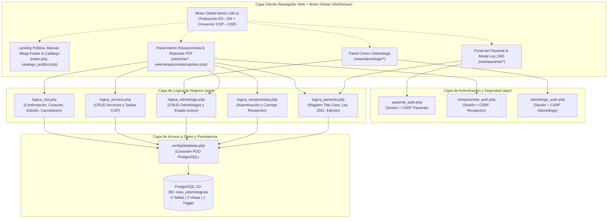
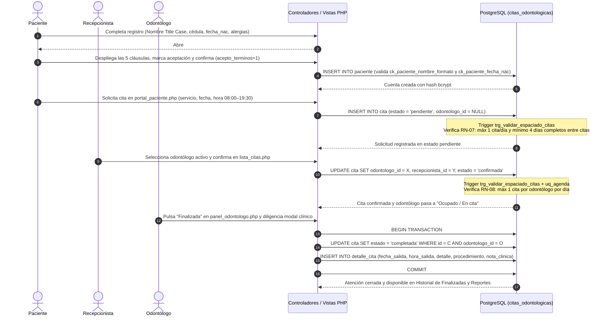

# MANUAL TÉCNICO DEL SISTEMA
## DENTIX — Sistema Integral de Gestión de Citas Odontológicas

---

### Ficha de Control Documental

| Campo | Detalle |
| :--- | :--- |
| **Nombre del Proyecto** | DENTIX — Sistema Web de Gestión de Citas Odontológicas |
| **Código / Sigla** | DENTIX-SYS |
| **Programa de Formación** | Tecnología en Análisis y Desarrollo de Software (ADSO) — SENA |
| **Tipo de Documento** | Manual Técnico de Arquitectura, Instalación, Operación y Mantenimiento |
| **Estado** | Aprobado / Producción Local |
| **Fecha de Emisión** | Noviembre de 2026 |
| **Arquitectura de Software** | Web Multicapa (Presentación / Lógica de Negocio / Persistencia Relacional PDO + Motor Cliente i18n/Divisas) |
| **Motor de Base de Datos** | PostgreSQL 12+ (`citas_odontologicas`) |

---

## Tabla de Contenido

1. [Introducción](#1-introducción)
   - 1.1 Propósito del Sistema
   - 1.2 Alcance del Documento
   - 1.3 Audiencia Objetivo
   - 1.4 Referencias Normativas y Técnicas
   - 1.5 Glosario de Términos y Acrónimos
2. [Requisitos del Sistema](#2-requisitos-del-sistema)
   - 2.1 Especificaciones de Hardware (Servidor y Cliente)
   - 2.2 Software Base y Dependencias del Servidor
   - 2.3 Sistemas Operativos Soportados
   - 2.4 Configuraciones de Red y Puertos
3. [Arquitectura y Diseño](#3-arquitectura-y-diseño)
   - 3.1 Descripción General de la Arquitectura
   - 3.2 Diagrama de Componentes y Capas
   - 3.3 Diagramas de Flujo de Procesos Críticos
   - 3.4 Estructura de la Base de Datos (Modelo Entidad-Relación)
   - 3.5 Diccionario de Datos de Entidades Principales
   - 3.6 Vistas SQL, Funciones PL/pgSQL, Triggers y Reglas de Negocio (`RN-01` a `RN-18`)
4. [Tecnologías y Stack Utilizado](#4-tecnologías-y-stack-utilizado)
   - 4.1 Lenguajes y Entorno Backend
   - 4.2 Frameworks, Librerías y Motor Global Frontend (`dentix-i18n.js`)
   - 4.3 Motor de Base de Datos y Extensiones
   - 4.4 Herramientas de Desarrollo y Control de Calidad
5. [Instalación y Despliegue](#5-instalación-y-despliegue)
   - 5.1 Preparación del Entorno (XAMPP / LAMPP y PostgreSQL)
   - 5.2 Clonación y Estructura del Proyecto
   - 5.3 Creación y Poblado de la Base de Datos
   - 5.4 Configuración de Variables de Conexión (`config/database.php`)
   - 5.5 Puesta en Marcha y Verificación del Servicio
   - 5.6 Credenciales Semilla de Prueba por Rol
6. [Módulos y Funciones](#6-módulos-y-funciones)
   - 6.1 Estructura General de Directorios del Proyecto
   - 6.2 Capa de Configuración (`config/`)
   - 6.3 Capa de Autenticación y Seguridad (`app/*_auth.php`)
   - 6.4 Capa de Lógica de Negocio y Controladores (`app/logica_*.php`)
   - 6.5 Capa de Presentación — Vistas por Módulo (`view/`) y Componentes Interactivos
7. [Seguridad, Cumplimiento Legal y Roles](#7-seguridad-cumplimiento-legal-y-roles)
   - 7.1 Políticas de Autenticación y Cifrado de Contraseñas
   - 7.2 Gestión Segura de Sesiones y Protección CSRF
   - 7.3 Prevención de Inyección SQL (SQLi), XSS y Validación de Calidad de Datos
   - 7.4 Cumplimiento Legal y Consentimiento Informado (Ley 1581 de 2012 y Ley 35 de 1989)
   - 7.5 Matriz de Control de Acceso Basado en Roles (RBAC)
8. [Resolución de Problemas (Troubleshooting)](#8-resolución-de-problemas-troubleshooting)
   - 8.1 Catálogo de Errores Comunes y Soluciones
   - 8.2 Auditoría y Ubicación de Bitácoras (Logs)
   - 8.3 Preguntas Frecuentes Técnicas (FAQ)
   - 8.4 Canales y Datos de Soporte Técnico
9. [Mantenimiento](#9-mantenimiento)
   - 9.1 Rutinas de Respaldo (Backup) y Restauración
   - 9.2 Mantenimiento Preventivo de la Base de Datos
   - 9.3 Aplicación de Parches y Actualizaciones de Código
   - 9.4 Plan de Migración y Escalabilidad

---

## 1. Introducción

### 1.1 Propósito del Sistema
**DENTIX** es un sistema de información web diseñado para centralizar, automatizar y asegurar el ciclo completo de agendamiento, atención clínica y control administrativo de una clínica odontológica. El sistema permite:
- A los **Pacientes**: registrarse validando nombre en formato propio (*Title Case*), cédula única, fecha de nacimiento obligatoria y alertas de alergias médicas (mediante selector categorizado, botones rápidos y campo descriptivo), previa lectura obligatoria de las 5 cláusulas del modal de **Términos, Condiciones y Tratamiento de Datos de Salud (Ley 1581 de 2012)**; autenticarse con su cédula, gestionar su perfil clínico, consultar el catálogo público de tratamientos (con tarifas en `COP` o `USD`) y solicitar citas en línea respetando las reglas de disponibilidad.
- A los **Recepcionistas (Administradores Operativos)**: administrar el CRUD completo de pacientes, odontólogos, servicios y citas; confirmar solicitudes pendientes asignando un profesional disponible; cancelar citas exigiendo el motivo de cancelación (`RN-06`); crear nuevas cuentas de recepción y consultar el **Módulo de Reportes Clínicos y Estadísticos** (con filtros por fecha, KPIs financieros en `COP`/`USD`, rankings de demanda e impresión en formato PDF).
- A los **Odontólogos**: consultar su agenda exclusiva de citas confirmadas con alertas visibles de alergias del paciente, registrar el cierre clínico de cada atención mediante el modal **Finalizar Cita y Reportar Detalle** (fecha y hora de salida, resumen de la cita, procedimiento realizado y nota clínica en `detalle_cita`) y auditar su historial de citas finalizadas con buscador en tiempo real.
- A **Todos los Usuarios**: conmutar instantáneamente toda la plataforma entre **Español (`ES`) e Inglés (`EN`)** y alternar la visualización de precios e ingresos entre **Pesos Colombianos (`COP`) y Dólares Estadounidenses (`USD`)**, además de consultar el **Manual Interactivo de Usuario** y el **Mega Pie de Página corporativo**.

### 1.2 Alcance del Documento
Este **Manual Técnico** constituye la referencia oficial de ingeniería para desarrolladores, administradores de bases de datos (DBA), personal de infraestructura y evaluadores técnicos del SENA. Cubre la arquitectura interna del software, el modelo relacional en PostgreSQL, los algoritmos de validación e integridad referencial (`RN-01` a `RN-18`), el motor cliente de internacionalización y divisas (`assests/js/dentix-i18n.js`), el procedimiento paso a paso de despliegue en entornos Linux/Windows (LAMPP/XAMPP), la descripción detallada de cada script PHP y los protocolos de seguridad, diagnóstico de fallos y respaldo.

### 1.3 Audiencia Objetivo
- **Desarrolladores de Software (Backend / Frontend)**: encargados del mantenimiento evolutivo y correctivo del código fuente PHP, SQL, CSS y JavaScript.
- **Administradores de Sistemas y Base de Datos**: responsables del aprovisionamiento de Apache, PHP-PDO, PostgreSQL, copias de seguridad (`pg_dump`) y monitoreo de logs.
- **Instructores y Evaluadores ADSO – SENA**: encargados de verificar la trazabilidad entre la Especificación de Requisitos de Software (`SRS_DENTIX`) y la implementación técnica.

### 1.4 Referencias Normativas y Técnicas
- **IEEE Std 830 / ISO/IEC/IEEE 29148**: Especificación de Requisitos de Software aplicada en el documento maestro `SRS_DENTIX`.
- **Normativa Legal Colombiana**:
  - **Ley Estatutaria 1581 de 2012 y Decreto 1377 de 2013**: Régimen General de Protección de Datos Personales (Habeas Data).
  - **Ley 35 de 1989**: Código de Ética del Odontólogo Colombiano.
  - **Resolución 1995 de 1999 (Ministerio de Salud)**: Normas para el manejo y reserva legal de la Historia Clínica.
- **Documentación Oficial de PHP 8.x**: Manual de PHP Data Objects (`PDO`) y funciones criptográficas nativas (`password_hash`, `password_verify`, `random_bytes`).
- **Documentación Oficial de PostgreSQL 12–16**: Lenguaje procedural `PL/pgSQL`, extensión `pgcrypto`, expresiones regulares POSIX (`~`) en restricciones `CHECK` y manejo de códigos `SQLSTATE`.
- **OWASP Top 10**: Prácticas de mitigación contra Inyección SQL (A03), Cross-Site Scripting (XSS), Falsificación de Peticiones en Sitios Cruzados (CSRF) y fallos de identificación y autenticación (A07).

### 1.5 Glosario de Términos y Acrónimos

| Término / Sigla | Definición Técnica |
| :--- | :--- |
| **ADSO** | Análisis y Desarrollo de Software (Programa de formación tecnológica del SENA). |
| **Bcrypt** | Función de derivación de claves criptográficas utilizada para almacenar hashes seguros de contraseñas (`$2y$` / `$2a$`). |
| **CRUD** | Acrónimo de *Create, Read, Update, Delete* (Crear, Leer, Actualizar y Eliminar registros). |
| **CSRF** | *Cross-Site Request Forgery*; ataque mitigado mediante tokens criptográficos de sesión por formulario (`csrf_token`). |
| **i18n (ES / EN)** | Sistema de internacionalización en cliente (`assests/js/dentix-i18n.js`) que traduce nodos de texto, atributos y alertas dinámicas entre Español e Inglés usando `WeakMap` y `MutationObserver`. |
| **Conversor COP / USD** | Mecanismo integrado en `dentix-i18n.js` que convierte tarifas e indicadores financieros entre Pesos Colombianos (`COP`) y Dólares (`USD`, tasa base `1 USD = $4.000 COP`) sobre elementos con atributo `data-cop-price`. |
| **Title Case (`ck_paciente_nombre_formato`)** | Regla de calidad de datos que exige que cada palabra del nombre del paciente inicie con letra mayúscula seguida de letras minúsculas. |
| **PDO** | *PHP Data Objects*; capa de abstracción de acceso a datos en PHP utilizada con el driver `pdo_pgsql`. |
| **RBAC** | *Role-Based Access Control*; control de acceso basado en los tres roles del sistema (`Paciente`, `Recepcionista`, `Odontólogo`). |
| **RN-01 a RN-18** | Reglas de Negocio implementadas en la capa cliente (JS), capa lógica (PHP) y motor relacional (`CHECK`, `UNIQUE` y `TRIGGER` en PostgreSQL). |
| **Slug Público** | Identificador textual único amigable para URL (`slug_publico` en la tabla `odontologo`, p. ej. `dra-ana-torres`). |

---

## 2. Requisitos del Sistema

### 2.1 Especificaciones de Hardware (Servidor y Cliente)

| Componente | Servidor Mínimo (Desarrollo / LAN) | Servidor Recomendado (Producción) | Equipo Cliente (Navegador Web) |
| :--- | :--- | :--- | :--- |
| **Procesador (CPU)** | Dual-Core 2.0 GHz (x86_64) | Quad-Core 2.8 GHz+ (Intel Xeon / AMD EPYC) | Dual-Core 1.6 GHz o superior |
| **Memoria RAM** | 4 GB DDR4 | 8 GB – 16 GB DDR4/DDR5 | 4 GB RAM |
| **Almacenamiento** | 10 GB libres (HDD/SSD) | 50 GB SSD NVMe (con partición para backups) | 500 MB libres para caché de navegador |
| **Red (NIC)** | Ethernet 100 Mbps / Wi-Fi | Gigabit Ethernet (1 Gbps) | Conexión LAN o banda ancha >= 10 Mbps |
| **Resolución de Pantalla** | N/A (Administración por SSH/Terminal) | N/A | 1366x768 px mín. (1920x1080 px recomendado, soporte móvil 360px+) |

### 2.2 Software Base y Dependencias del Servidor

| Componente de Software | Versión Requerida | Observaciones / Extensiones Obligatorias |
| :--- | :--- | :--- |
| **Servidor Web** | Apache HTTP Server `2.4.x` | Módulos `mod_rewrite` y soporte PHP activo. |
| **Intérprete Backend** | PHP `8.0` a `8.3` | Extensiones obligatorias: `pdo`, `pdo_pgsql`, `pgsql`, `mbstring`, `session`, `openssl`. |
| **Motor de Base de Datos** | PostgreSQL `12.x` a `16.x` | Extensión `pgcrypto` habilitada en la base de datos `citas_odontologicas`. |
| **Navegadores Soportados** | Google Chrome `115+`, Firefox `115+`, Microsoft Edge `115+`, Safari `16+` | Soporte completo para CSS Grid, Flexbox, variables CSS, `WeakMap`, `MutationObserver` y `localStorage`. |

### 2.3 Sistemas Operativos Soportados
- **Entorno Servidor**:
  - **GNU/Linux (Recomendado)**: Ubuntu Server/Desktop 20.04 LTS, 22.04 LTS, 24.04 LTS, Debian 11/12 (ejecutando LAMPP en `/opt/lampp` y servicio nativo `postgresql`).
  - **Microsoft Windows**: Windows 10 / 11 Pro o Windows Server 2019/2022 (ejecutando XAMPP en `C:\xampp` y PostgreSQL oficial).
- **Entorno Cliente**: Cualquier sistema operativo de escritorio o móvil (Linux, Windows, macOS, Android, iOS) con navegador web moderno.

### 2.4 Configuraciones de Red y Puertos

| Servicio | Protocolo | Puerto por Defecto | Alcance | Propósito en DENTIX |
| :--- | :--- | :--- | :--- | :--- |
| **Apache HTTP Server** | TCP / HTTP | `8080` (o `80`) | LAN / Público | Servir la aplicación web en `http://localhost:8080/DENTIX/`. |
| **PostgreSQL Server** | TCP | `5432` | Localhost (`127.0.0.1`) | Comunicación entre PHP (`PDO`) y la base de datos `citas_odontologicas`. |

> [!IMPORTANT]
> Para que las librerías visuales externas (Bootstrap 5.3.2, Font Awesome 6.4.2, Google Fonts y GSAP 3.12.2) carguen desde sus respectivos CDN, el equipo cliente debe contar con salida a Internet por el puerto `443` (HTTPS).

---

## 3. Arquitectura y Diseño

### 3.1 Descripción General de la Arquitectura
DENTIX implementa una **Arquitectura Web Multicapa Basada en Vistas y Controladores Lógicos** sobre PHP y PostgreSQL, complementada con un motor transversal de interfaz en el cliente:

1. **Capa de Presentación y Experiencia de Usuario (`view/` + `index.php` + `assests/`)**:
   - Interfaces de usuario responsivas organizadas por módulo (`paciente`, `odontologo`, `recepcionista`, `servicio`, `cita`). Renderizan datos escapados con `htmlspecialchars()` y envían formularios mediante peticiones HTTP `POST` o filtros `GET`.
   - Incluye el motor global [`assests/js/dentix-i18n.js`](file:///opt/lampp/htdocs/DENTIX/assests/js/dentix-i18n.js) para traducción instantánea Español ↔ Inglés y conversión monetaria `COP` ↔ `USD`, el modal interactivo de Términos y Condiciones (`#termsModal`), el Manual Interactivo (`#userManualModal`) y el Mega Pie de Página corporativo (`.mega-footer`).
2. **Capa de Seguridad y Sesiones (`app/*_auth.php`)**:
   - Middlewares especializados por rol que gestionan el ciclo de vida de la sesión PHP (`session_start`, cookies `HttpOnly`, `SameSite=Lax`), la generación/validación de tokens CSRF y la protección de rutas privadas.
3. **Capa de Lógica de Negocio (`app/logica_*.php`)**:
   - Controladores (`logica_paciente.php`, `logica_recepcionista.php`, `logica_cita.php`, `logica_odontologo.php`, `logica_servicio.php`) que validan las reglas de negocio (`RN-01` a `RN-18`), ejecutan sentencias preparadas PDO, gestionan transacciones atómicas y redirigen con mensajes de retroalimentación.
4. **Capa de Persistencia y Reglas Relacionales (`config/database.php` + `database/citas_odontologicas`)**:
   - Instancia PDO conectada a PostgreSQL, respaldada por restricciones de dominio (`CHECK` y `UNIQUE`), llaves foráneas, vistas operativas y el disparador PL/pgSQL `trg_validar_espaciado_citas` que garantiza las reglas de agenda en el motor.

### 3.2 Diagrama de Componentes y Capas



### 3.3 Diagramas de Flujo de Procesos Críticos

#### Ciclo Completo: Registro con Consentimiento Ley 1581 -> Agendamiento -> Confirmación -> Finalización Clínica



### 3.4 Estructura de la Base de Datos (Modelo Entidad-Relación)

```mermaid
erDiagram
    PACIENTE ||--o{ CITA : "solicita (paciente_id)"
    ODONTOLOGO ||--o{ CITA : "atiende (odontologo_id)"
    RECEPCIONISTA ||--o{ CITA : "gestiona (recepcionista_id)"
    SERVICIO ||--o{ CITA : "define (servicio_id)"
    CITA ||--o| DETALLE_CITA : "documenta (cita_id UQ)"
    SERVICIO ||--o{ DETALLE_CITA : "aplica (servicio_id)"

    PACIENTE {
        int id PK
        varchar nombre "CHECK Title Case"
        varchar telefono
        varchar email
        date fecha_nac "NOT NULL, CHECK <= hoy"
        varchar alergias "Alertas médicas"
        varchar cedula UK "NOT NULL"
        varchar password_hash "NOT NULL (bcrypt)"
    }

    RECEPCIONISTA {
        int id PK
        varchar nombre
        varchar telefono
        varchar email UK
        varchar password_hash
        boolean activo
        timestamp ultimo_acceso
    }

    ODONTOLOGO {
        int id PK
        varchar nombre
        varchar especialidad
        varchar consultorio
        varchar slug_publico UK
        varchar email UK
        varchar password_hash
        boolean activo
        timestamp ultimo_acceso
    }

    SERVICIO {
        int id PK
        varchar nombre UK
        smallint duracion_min "CHECK >= 15"
        numeric precio "COP, CHECK >= 0"
        text descripcion
    }

    CITA {
        int id PK
        int paciente_id FK
        int odontologo_id FK "NULLable en pendiente"
        int servicio_id FK
        int recepcionista_id FK "NULLable"
        date fecha
        time hora "08:00 a 19:30 (00/30)"
        estado_cita estado "pendiente|confirmada|cancelada|completada|no_show"
        varchar motivo
        varchar motivo_cancelacion "CHECK obligatorio si cancelada"
        timestamp creado_en
    }

    DETALLE_CITA {
        int id PK
        int cita_id FK_UK
        int servicio_id FK
        varchar detalle
        text procedimiento
        text nota_clinica
        date fecha_salida
        time hora_salida
        timestamp creado_en
    }
```

### 3.5 Diccionario de Datos de Entidades Principales

#### 1. Tabla `public.paciente`
Almacena la información personal, alertas de alergias médicas y credenciales de acceso de los pacientes.

| Columna | Tipo de Dato | Nulo | Restricciones / Índices | Descripción |
| :--- | :--- | :---: | :--- | :--- |
| `id` | `INTEGER` (Identity) | No | `PK (paciente_pkey)` | Identificador único autoincremental del paciente. |
| `nombre` | `VARCHAR(60)` | No | `ck_paciente_nombre`, `ck_paciente_nombre_formato` | Nombre completo en formato **Nombre Propio (Title Case)**: cada palabra inicia con mayúscula seguida de minúsculas. |
| `telefono` | `VARCHAR(15)` | No | `ck_paciente_telefono` | Número telefónico de contacto (mínimo 7 caracteres válidos). |
| `email` | `VARCHAR(80)` | Sí | `ck_paciente_email` | Correo electrónico validado por expresión regular. |
| `fecha_nac` | `DATE` | No | `ck_paciente_fecha_nac` | Fecha de nacimiento obligatoria (`>= 1900-01-01` y `<= CURRENT_DATE`). |
| `alergias` | `VARCHAR(120)` | Sí | — | Alergias médicas registradas (selector, chips rápidos o texto; por defecto `'Ninguna registrada'`). |
| `cedula` | `VARCHAR(30)` | No | `UNIQUE (uq_paciente_cedula)`, `ck_paciente_cedula` | Documento de identidad único (5 a 20 caracteres alfanuméricos); usuario de login. |
| `password_hash` | `VARCHAR(255)` | No | `ck_paciente_password_hash` | Hash bcrypt de la contraseña de acceso (`8` a `72` caracteres en origen). |

#### 2. Tabla `public.recepcionista`
Almacena los usuarios con rol administrativo/recepción encargados de operar el panel de gestión y reportes.

| Columna | Tipo de Dato | Nulo | Restricciones / Índices | Descripción |
| :--- | :--- | :---: | :--- | :--- |
| `id` | `INTEGER` (Identity) | No | `PK (recepcionista_pkey)` | Identificador único de la recepcionista. |
| `nombre` | `VARCHAR(60)` | No | `ck_recep_nombre` | Nombre completo de la recepcionista. |
| `telefono` | `VARCHAR(15)` | Sí | `ck_recep_telefono` | Teléfono de contacto interno/personal. |
| `email` | `VARCHAR(80)` | No | `UNIQUE (uq_recep_email)`, `ck_recep_email` | Correo electrónico institucional (usuario de login). |
| `password_hash` | `VARCHAR(255)` | No | `ck_recep_password_hash` | Hash bcrypt de la contraseña. |
| `activo` | `BOOLEAN` | No | `DEFAULT TRUE` | Estado de habilitación de la cuenta (`true` / `false`). |
| `ultimo_acceso` | `TIMESTAMP` | Sí | — | Marca de tiempo del último inicio de sesión exitoso. |

#### 3. Tabla `public.odontologo`
Registra los profesionales de odontología, su especialidad, consultorio asignado y credenciales clínicas.

| Columna | Tipo de Dato | Nulo | Restricciones / Índices | Descripción |
| :--- | :--- | :---: | :--- | :--- |
| `id` | `INTEGER` (Identity) | No | `PK (odontologo_pkey)` | Identificador único del odontólogo. |
| `nombre` | `VARCHAR(60)` | No | `ck_odontologo_nombre` | Nombre profesional completo. |
| `especialidad` | `VARCHAR(40)` | No | `ck_odontologo_especialidad` | Especialidad clínica (Odontología general, Ortodoncia, Endodoncia, etc.). |
| `consultorio` | `VARCHAR(20)` | Sí | `ck_odontologo_consultorio` | Consultorio físico asignado (p. ej. `Consultorio 1`). |
| `slug_publico` | `VARCHAR(40)` | No | `UNIQUE`, `ck_odontologo_slug` | Identificador textual único en minúsculas y guiones (p. ej. `dra-ana-torres`). |
| `email` | `VARCHAR(80)` | No | `UNIQUE (uq_odont_email)`, `ck_odont_email` | Correo electrónico para inicio de sesión en el panel clínico. |
| `password_hash` | `VARCHAR(255)` | No | `ck_odont_password_hash` | Hash bcrypt de la contraseña. |
| `activo` | `BOOLEAN` | No | `DEFAULT TRUE` | Indica si el odontólogo está habilitado para iniciar sesión y recibir citas. |
| `ultimo_acceso` | `TIMESTAMP` | Sí | — | Fecha y hora del último ingreso al panel clínico. |

#### 4. Tabla `public.servicio`
Catálogo de tratamientos y procedimientos odontológicos ofrecidos por la clínica.

| Columna | Tipo de Dato | Nulo | Restricciones / Índices | Descripción |
| :--- | :--- | :---: | :--- | :--- |
| `id` | `INTEGER` (Identity) | No | `PK (servicio_pkey)` | Identificador único del servicio. |
| `nombre` | `VARCHAR(60)` | No | `UNIQUE (uq_servicio_nombre)` | Nombre único del tratamiento odontológico. |
| `duracion_min` | `SMALLINT` | No | `DEFAULT 30`, `ck_servicio_duracion (>= 15)` | Duración estimada en minutos (mínimo 15 minutos). |
| `precio` | `NUMERIC(10,2)` | No | `ck_servicio_precio (>= 0)` | Tarifa base del servicio en Pesos Colombianos (`COP`), convertible dinámicamente a `USD` en interfaz. |
| `descripcion` | `TEXT` | Sí | — | Descripción clínica mostrada en el catálogo público y administrativo. |

#### 5. Tabla `public.cita`
Entidad transaccional central que articula pacientes, servicios, odontólogos y recepcionistas.

| Columna | Tipo de Dato | Nulo | Restricciones / Índices | Descripción |
| :--- | :--- | :---: | :--- | :--- |
| `id` | `INTEGER` (Identity) | No | `PK (cita_pkey)` | Identificador único de la cita. |
| `paciente_id` | `INTEGER` | No | `FK -> paciente(id) ON DELETE CASCADE` | Paciente titular de la cita. |
| `odontologo_id` | `INTEGER` | Sí | `FK -> odontologo(id) ON DELETE RESTRICT` | Odontólogo asignado (`NULL` mientras la solicitud está `pendiente`). |
| `servicio_id` | `INTEGER` | No | `FK -> servicio(id) ON DELETE RESTRICT` | Tratamiento solicitado. |
| `recepcionista_id` | `INTEGER` | Sí | `FK -> recepcionista(id) ON DELETE SET NULL` | Recepcionista que confirmó o gestionó la cita. |
| `fecha` | `DATE` | No | `IDX (ix_cita_fecha)` | Fecha programada de la cita. |
| `hora` | `TIME` | No | `ck_cita_horario (08:00 a 19:30, min 00/30)` | Hora en bloques exactos de 30 minutos (`RN-03`). |
| `estado` | `estado_cita` (ENUM) | No | `DEFAULT 'pendiente'` | Valores: `'pendiente'`, `'confirmada'`, `'cancelada'`, `'completada'`, `'no_show'`. |
| `motivo` | `VARCHAR(120)` | Sí | — | Motivo de consulta indicado al solicitar la cita. |
| `motivo_cancelacion` | `VARCHAR(120)` | Sí | `ck_cita_cancelacion (RN-06)` | Obligatorio (`NOT NULL`) cuando `estado = 'cancelada'`; debe ser `NULL` en cualquier otro estado. |
| `creado_en` | `TIMESTAMP` | No | `DEFAULT NOW()` | Marca temporal de creación del registro. |

#### 6. Tabla `public.detalle_cita`
Almacena el registro clínico inmutable generado por el odontólogo al finalizar una cita.

| Columna | Tipo de Dato | Nulo | Restricciones / Índices | Descripción |
| :--- | :--- | :---: | :--- | :--- |
| `id` | `INTEGER` (Identity) | No | `PK (detalle_cita_pkey)` | Identificador único del detalle clínico. |
| `cita_id` | `INTEGER` | No | `FK -> cita(id) ON DELETE CASCADE`, `UNIQUE (uq_detalle_cita)` | Relación 1:1 con la cita atendida (`RN-04`). |
| `servicio_id` | `INTEGER` | No | `FK -> servicio(id) ON DELETE RESTRICT` | Servicio efectivamente practicado. |
| `detalle` | `VARCHAR(200)` | Sí | `ck_detalle_cita_contenido` | Resumen clínico de la atención. |
| `procedimiento` | `TEXT` | Sí | — | Descripción técnica del procedimiento ejecutado. |
| `nota_clinica` | `TEXT` | Sí | — | Novedades, recomendaciones o evolución clínica. |
| `fecha_salida` | `DATE` | Sí | — | Fecha real de salida del paciente del consultorio. |
| `hora_salida` | `TIME` | Sí | — | Hora real de finalización de la consulta. |
| `creado_en` | `TIMESTAMP` | No | `DEFAULT NOW()` | Timestamp del registro clínico. |

### 3.6 Vistas SQL, Funciones PL/pgSQL, Triggers y Reglas de Negocio (`RN-01` a `RN-18`)

| Objeto / Regla | Tipo | Especificación e Implementación Técnica |
| :--- | :--- | :--- |
| `v_agenda_dia` | `VIEW` | Consolida la agenda diaria uniendo `cita`, `paciente`, `odontologo` (`LEFT JOIN`, mostrando `'Por asignar'` si es `NULL`) y `servicio`. |
| `v_historial_paciente` | `VIEW` | Unifica el historial clínico del paciente integrando `paciente` (con `alergias`), `cita`, `servicio`, `odontologo` y `detalle_cita` (`fecha_salida`, `hora_salida`). |
| `fn_validar_espaciado_citas_paciente()` / `trg_validar_espaciado_citas` | `FUNCTION` + `TRIGGER` | Trigger `BEFORE INSERT OR UPDATE` en `public.cita` que aplica en el motor:<br/>1. **`RN-07` (Frecuencia de citas del paciente)**: impide que un paciente tenga más de **1 cita el mismo día** y exige al menos **4 días completos de diferencia** (`ABS(c.fecha - NEW.fecha) <= 4`) entre citas activas o completadas.<br/>2. **`RN-08` (Límite diario por odontólogo)**: impide asignar a un mismo odontólogo más de **1 cita por día** (`confirmada` o `completada`). |
| `RN-01` a `RN-06` | Reglas de Dominio | `RN-01`: solo odontólogos activos reciben citas; `RN-02`: `uq_agenda (odontologo_id, fecha, hora)`; `RN-03`: horario `08:00` a `19:30` cada 30 min (`ck_cita_horario`); `RN-04`: máximo un detalle clínico por cita (`uq_detalle_cita`); `RN-05`: datos obligatorios de paciente; `RN-06`: motivo obligatorio al cancelar (`ck_cita_cancelacion`). |
| `RN-09` a `RN-14` | Reglas Operativas | `RN-09`: solicitud nace con `odontologo_id = NULL`; `RN-10`: `cedula` única; `RN-11`: `servicio.nombre` único; `RN-12`: bloqueo de borrado de servicios con citas (`ON DELETE RESTRICT`); `RN-13` y `RN-14`: cierre clínico atómico por el odontólogo titular exigiendo fecha/hora de salida, resumen y procedimiento. |
| `RN-15` | Calidad de Datos | Todo nombre de paciente debe cumplir formato **Nombre Propio (Title Case)** mediante regex en JS, PHP y `CHECK ck_paciente_nombre_formato` en PostgreSQL. |
| `RN-16` | Cumplimiento Legal | Todo registro público de paciente exige desplegar los 5 botones `"Ver más..."` del modal `#termsModal` y aceptar el consentimiento informado (`acepto_terminos = 1`). |
| `RN-17` y `RN-18` | Internacionalización y Moneda | Conversión dinámica `COP` ↔ `USD` (`1 USD = $4.000 COP`) y traducción `ES` ↔ `EN` mediante `assests/js/dentix-i18n.js`, con persistencia en `localStorage` y cookies (`dentix_lang`, `dentix_currency`). |

---

## 4. Tecnologías y Stack Utilizado

### 4.1 Lenguajes y Entorno Backend
- **PHP 8.x**: Lenguaje principal del lado del servidor con manejo de sesiones seguras, expresiones regulares Unicode (`/\A[[:upper:]][[:lower:]]+(?:\s+[[:upper:]][[:lower:]]+)*\z/u`), transacciones PDO y control de excepciones `PDOException`.
- **PDO (`pdo_pgsql`)**: Driver nativo de conexión a PostgreSQL configurado con `PDO::ERRMODE_EXCEPTION`, `PDO::FETCH_ASSOC` y `PDO::ATTR_EMULATE_PREPARES => false`.

### 4.2 Frameworks, Librerías y Motor Global Frontend (`dentix-i18n.js`)
- **HTML5 Semántico y CSS3 Modular (`assests/css/`)**:
  - [`assests/css/index.css`](file:///opt/lampp/htdocs/DENTIX/assests/css/index.css): Estilos de la página principal, tarjetas interactivas, Manual de Usuario (`#userManualModal`), modal legal de Términos y Condiciones (`#termsModal`) y Mega Pie de Página corporativo en tono blanco menta y aguamarina suave (`.mega-footer`).
  - [`assests/css/admin.css`](file:///opt/lampp/htdocs/DENTIX/assests/css/admin.css): Sistema de diseño de paneles de Recepción, Odontólogo y Reportes con reglas `@media print` para exportación limpia a PDF.
  - [`assests/css/paciente.css`](file:///opt/lampp/htdocs/DENTIX/assests/css/paciente.css): Estilos del Portal y Perfil del Paciente.
- **Motor Global de Idioma y Divisas ([`assests/js/dentix-i18n.js`](file:///opt/lampp/htdocs/DENTIX/assests/js/dentix-i18n.js))**:
  - Presente en [`index.php`](file:///opt/lampp/htdocs/DENTIX/index.php) y en las **22 vistas** dentro de `view/*/*.php`.
  - **Traducción Instantánea (`ES` ↔ `EN`)**: Almacena el texto original en español dentro de un `WeakMap` (`originalTextMap`) para restaurarlo sin pérdida al volver a `ES`, traduce textos exactos y patrones dinámicos (`regexRules`), atributos (`placeholder`, `title`, `aria-label`, `value` de botones) e intercepta `window.confirm` y `window.alert`.
  - **Conversión Monetaria (`COP` ↔ `USD`)**: Detecta todos los nodos con atributo `data-cop-price` y convierte precios unitarios y totales de ingresos entre Pesos Colombianos (`$ 150.000 COP`) y Dólares Estadounidenses (`$37.50 USD` / `$38 USD`) usando la tasa `1 USD = $4.000 COP`.
  - **Widget Flotante (`#dentixFloatingLang`)**: En las vistas internas que no poseen el Mega Footer de `index.php`, inyecta automáticamente en la esquina inferior derecha una píldora flotante con selectores `ES / EN` y `COP / USD` (oculta automáticamente al imprimir con `@media print`).
- **Bootstrap `5.3.2`**, **Font Awesome `6.4.2`**, **Google Fonts (`Manrope` & `Sora`)** y **GSAP `3.12.2` + `ScrollTrigger`** ([`assests/js/index-animations.js`](file:///opt/lampp/htdocs/DENTIX/assests/js/index-animations.js)).

### 4.3 Motor de Base de Datos y Extensiones
- **PostgreSQL `12+`**: Motor relacional transaccional ACID.
- **Extensión `pgcrypto`**: Utilizada en [`database/citas_odontologicas`](file:///opt/lampp/htdocs/DENTIX/database/citas_odontologicas) mediante `crypt('12141214', gen_salt('bf', 10))` para generar hashes bcrypt compatibles con `password_verify()` de PHP.

---

## 5. Instalación y Despliegue

### 5.1 Preparación del Entorno (XAMPP / LAMPP y PostgreSQL)
1. Verificar que las extensiones `pdo_pgsql`, `pgsql` y `mbstring` estén habilitadas en `/opt/lampp/etc/php.ini`:
   ```ini
   extension=pdo_pgsql
   extension=pgsql
   extension=mbstring
   ```
2. Validar módulos desde la terminal:
   ```bash
   /opt/lampp/bin/php -m | grep -E "pdo_pgsql|mbstring"
   ```

### 5.2 Clonación y Estructura del Proyecto
Ubicar el proyecto dentro del directorio público de Apache (`htdocs`):
```bash
cd /opt/lampp/htdocs
git clone <URL_DEL_REPOSITORIO> DENTIX
cd /opt/lampp/htdocs/DENTIX
```

### 5.3 Creación y Poblado de la Base de Datos
El script oficial [`database/citas_odontologicas`](file:///opt/lampp/htdocs/DENTIX/database/citas_odontologicas) crea la extensión `pgcrypto`, el tipo `estado_cita`, las 6 tablas con sus restricciones `CHECK`/`UNIQUE`, el trigger `trg_validar_espaciado_citas`, las 2 vistas, los 9 índices y los datos semilla iniciales:
```bash
psql -h 127.0.0.1 -p 5432 -U postgres -d citas_odontologicas -f /opt/lampp/htdocs/DENTIX/database/citas_odontologicas
```

### 5.4 Configuración de Variables de Conexión (`config/database.php`)
1. Copiar la plantilla base:
   ```bash
   cp /opt/lampp/htdocs/DENTIX/config/database.example.php /opt/lampp/htdocs/DENTIX/config/database.php
   ```
2. Configurar las credenciales de PostgreSQL en [`config/database.php`](file:///opt/lampp/htdocs/DENTIX/config/database.php).

### 5.5 Puesta en Marcha y Verificación del Servicio
```bash
sudo systemctl start postgresql
sudo /opt/lampp/lampp startapache
```
- **URL Principal**: `http://localhost:8080/DENTIX/`
- **Catálogo Público de Tratamientos**: `http://localhost:8080/DENTIX/view/servicio/catalogo_publico.php`

### 5.6 Credenciales Semilla de Prueba por Rol
El script oficial [`database/citas_odontologicas`](file:///opt/lampp/htdocs/DENTIX/database/citas_odontologicas) aprovisiona las siguientes cuentas iniciales (todas con la contraseña de prueba **`12141214`**):

| Rol del Sistema | Vista de Acceso | Usuario (Correo o Cédula) | Contraseña |
| :--- | :--- | :--- | :--- |
| **Recepcionista** | `view/recepcionista/lista_recepcionista.php` | `jose.recepcion@clinica.com`<br/>`maria.recepcion@clinica.com` | `12141214` |
| **Odontólogo** | `view/odontologo/login_odontologo.php` | `luis.mendoza@clinica.com`<br/>`ana.torres@clinica.com`<br/>`carlos.ruiz@clinica.com`<br/>`sofia.vargas@clinica.com`<br/>`diego.herrera@clinica.com` | `12141214` |
| **Paciente** | `view/paciente/login_paciente.php` | Cédulas: `1001112233` (Laura Gómez), `1004445566` (Carlos Pérez), `1076907716` (Juan Steven), `1005556677` (Andrés Morales), `1007778899` (Valentina Castro) | `12141214` |

---

## 6. Módulos y Funciones

### 6.1 Estructura General de Directorios del Proyecto

```text
DENTIX/
├── app/                                  # Capa de Lógica de Negocio y Autenticación
│   ├── logica_cita.php                   # Controlador CRUD, confirmación y cancelación de Citas
│   ├── logica_odontologo.php             # Controlador CRUD de Odontólogos
│   ├── logica_paciente.php               # Registro (Title Case + Ley 1581), activación y edición de Pacientes
│   ├── logica_recepcionista.php          # Autenticación y creación de cuentas de Recepción
│   ├── logica_servicio.php               # Controlador CRUD de Servicios odontológicos
│   ├── odontologo_auth.php               # Middleware de sesión y CSRF para Odontólogos
│   ├── paciente_auth.php                 # Middleware de sesión y CSRF para Pacientes
│   └── recepcionista_auth.php            # Middleware de sesión y CSRF para Recepcionistas
├── assests/                              # Recursos estáticos (CSS, JS, Imágenes)
│   ├── css/
│   │   ├── admin.css                     # Estilos de paneles administrativos y reportes (@media print)
│   │   ├── index.css                     # Estilos de landing, Manual Interactivo, #termsModal y Mega Footer
│   │   └── paciente.css                  # Estilos del portal y perfil del paciente
│   ├── img/
│   │   └── proyecto-placeholder.svg      # Ilustración vectorial institucional
│   └── js/
│       ├── admin-animations.js           # Interacciones de paneles administrativos
│       ├── animaciones.js                # Utilidades de animación general
│       ├── dentix-i18n.js                # Motor global de traducción ES↔EN y conversión COP↔USD
│       └── index-animations.js           # Animaciones GSAP, Manual Interactivo y Mega Footer en vivo
├── config/                               # Capa de Configuración de Base de Datos
│   ├── database.example.php              # Plantilla de conexión PDO
│   └── database.php                      # Credenciales activas de conexión PDO (excluido en .gitignore)
├── database/                             # Scripts SQL del Motor PostgreSQL
│   └── citas_odontologicas               # Script maestro DDL + DML + Vistas + Trigger PL/pgSQL
├── manuales/                             # Documentación Técnica y de Usuario
│   ├── MANUAL_TECNICO.md                 # Manual Técnico de Arquitectura, Despliegue y Mantenimiento
│   └── MANUAL_USUARIO.md                 # Manual de Usuario y Guía Paso a Paso por Rol
├── view/                                 # Capa de Presentación (22 vistas PHP/HTML5)
│   ├── cita/
│   │   ├── editar_cita.php               # Edición y reprogramación de cita
│   │   ├── form_cita.php                 # Creación manual de cita desde recepción
│   │   └── lista_citas.php               # Panel de solicitudes pendientes, confirmadas y cancelación con motivo
│   ├── odontologo/
│   │   ├── cerrar_sesion_odontologo.php  # Cierre seguro de sesión (POST + CSRF)
│   │   ├── editar_odontologo.php         # Edición de datos, slug público y estado Activo/Inactivo
│   │   ├── form_odontologo.php           # Registro de nuevo odontólogo
│   │   ├── historial_finalizadas.php     # Historial clínico de citas completadas con buscador
│   │   ├── lista_odontologos.php         # Directorio de odontólogos con estado en tiempo real
│   │   ├── login_odontologo.php          # Inicio de sesión del odontólogo
│   │   └── panel_odontologo.php          # Agenda del odontólogo y modal "Finalizar Cita y Reportar Detalle"
│   ├── paciente/
│   │   ├── agendar_cita.php              # Redirección al portal de solicitud de citas
│   │   ├── cerrar_sesion_paciente.php    # Cierre seguro de sesión (POST + CSRF)
│   │   ├── editar_paciente.php           # Edición administrativa de paciente
│   │   ├── form_paciente.php             # Registro de paciente con alergias, fecha_nac y #termsModal
│   │   ├── lista_pacientes.php           # Directorio de pacientes con insignias de alergias
│   │   ├── login_paciente.php            # Acceso por cédula y contraseña
│   │   ├── perfil_paciente.php           # Perfil personal, estadísticas, alergias e historial de citas
│   │   └── portal_paciente.php           # Solicitud autónoma de citas (valida RN-03 y RN-07)
│   ├── recepcionista/
│   │   ├── boton_cerrar_sesion.php       # Tarjeta de perfil lateral + botón de cierre de sesión
│   │   ├── cerrar_sesion_recepcionista.php # Cierre seguro de sesión (POST + CSRF)
│   │   ├── form_recepcionista.php        # Creación de cuenta de recepción
│   │   ├── lista_recepcionista.php       # Inicio de sesión de recepción
│   │   └── reportes.php                  # Módulo de Reportes Clínicos y Estadísticas (COP/USD + PDF)
│   └── servicio/
│       ├── catalogo_publico.php          # Catálogo público con íconos y precios COP/USD
│       ├── editar_servicio.php           # Edición de servicio con vista previa USD en tiempo real
│       ├── form_servicio.php             # Registro de servicio con vista previa USD en tiempo real
│       └── lista_servicios.php           # Listado, edición y eliminación segura de servicios
├── .gitignore                            # Reglas de exclusión de archivos locales
├── index.php                             # Página principal con Manual Interactivo y Mega Footer
└── README.md                             # Resumen general del repositorio
```

### 6.2 Capa de Configuración (`config/`)
- [`config/database.php`](file:///opt/lampp/htdocs/DENTIX/config/database.php): Construye el DSN `pgsql:host=$host;port=$port;dbname=$dbname` e instancia el objeto `$pdo`. En caso de error de conexión, registra el detalle técnico en `error_log` y presenta un mensaje controlado.

### 6.3 Capa de Autenticación y Seguridad (`app/*_auth.php`)
- [`app/paciente_auth.php`](file:///opt/lampp/htdocs/DENTIX/app/paciente_auth.php), [`app/recepcionista_auth.php`](file:///opt/lampp/htdocs/DENTIX/app/recepcionista_auth.php) y [`app/odontologo_auth.php`](file:///opt/lampp/htdocs/DENTIX/app/odontologo_auth.php): Inicializan sesiones seguras con cookies `HttpOnly` y `SameSite=Lax`, regeneran el ID de sesión al autenticar, generan/validan tokens CSRF mediante `hash_equals()` y destruyen la sesión de forma segura por petición `POST`.

### 6.4 Capa de Lógica de Negocio y Controladores (`app/logica_*.php`)
1. **[`app/logica_paciente.php`](file:///opt/lampp/htdocs/DENTIX/app/logica_paciente.php)**:
   - Valida nombre en formato **Nombre Propio (Title Case)**, cédula, `fecha_nac` obligatoria no futura, alergias médicas, teléfono, correo y contraseña (`8` a `72` caracteres).
   - En el registro público verifica obligatoriamente que `acepto_terminos === '1'` (proveniente de `#termsModal`).
   - Permite activar cuentas preexistentes sin contraseña o actualizar datos de pacientes desde recepción (`accion = actualizar`).
2. **[`app/logica_cita.php`](file:///opt/lampp/htdocs/DENTIX/app/logica_cita.php)**:
   - Gestiona creación manual (`form_cita.php`), edición/actualización (`editar_cita.php`) y cancelación con motivo obligatorio (`RN-06`), capturando excepciones de PostgreSQL (`RN-07`, `RN-08`, `uq_agenda`) para mostrar alertas claras.
3. **[`app/logica_odontologo.php`](file:///opt/lampp/htdocs/DENTIX/app/logica_odontologo.php)**:
   - Registra nuevos especialistas generando automáticamente su `slug_publico` único y permite actualizar su nombre, especialidad, consultorio, correo, contraseña opcional y estado `activo` (`TRUE`/`FALSE`).
4. **[`app/logica_servicio.php`](file:///opt/lampp/htdocs/DENTIX/app/logica_servicio.php)**:
   - Administra el alta, edición (`descripcion`, `duracion_min >= 15`, `precio >= 0`) y eliminación (`accion = eliminar`) de servicios odontológicos, bloqueando el borrado si el servicio está referenciado en `cita` o `detalle_cita`.
5. **[`app/logica_recepcionista.php`](file:///opt/lampp/htdocs/DENTIX/app/logica_recepcionista.php)**:
   - Autentica cuentas activas de recepción actualizando `ultimo_acceso` y permite crear nuevas cuentas administrativas.

---

## 7. Seguridad, Cumplimiento Legal y Roles

### 7.1 Políticas de Autenticación y Cifrado de Contraseñas
- Todas las contraseñas (`paciente`, `recepcionista`, `odontologo`) se almacenan cifradas con **bcrypt** (`password_hash($pass, PASSWORD_DEFAULT)`).
- El inicio de sesión en recepción y odontología exige `activo = TRUE` y registra `ultimo_acceso = NOW()`.

### 7.2 Gestión Segura de Sesiones y Protección CSRF
- Cookies configuradas con `httponly => true` y `samesite => 'Lax'`.
- Regeneración de sesión (`session_regenerate_id(true)`) en cada login.
- Token CSRF obligatorio en todos los formularios `POST` y cierres de sesión.

### 7.3 Prevención de Inyección SQL (SQLi), XSS y Validación de Calidad de Datos
- **Mitigación SQLi**: Consultas 100 % parametrizadas con `$pdo->prepare()`.
- **Mitigación XSS**: Salidas escapadas con `htmlspecialchars(..., ENT_QUOTES, 'UTF-8')`.
- **Calidad de Datos Sincronizada**: Validación en tres capas (HTML5/JS + PHP + PostgreSQL `CHECK`) para nombres propios (`ck_paciente_nombre_formato`), fechas de nacimiento (`ck_paciente_fecha_nac`), horarios (`ck_cita_horario`) y motivos de cancelación (`ck_cita_cancelacion`).

### 7.4 Cumplimiento Legal y Consentimiento Informado (Ley 1581 de 2012 y Ley 35 de 1989)
- En [`view/paciente/form_paciente.php`](file:///opt/lampp/htdocs/DENTIX/view/paciente/form_paciente.php), antes de enviar el registro, el sistema intercepta el evento `submit`, verifica los campos del formulario y abre el modal `#termsModal` con **5 cláusulas normativas**:
  1. Autorización de Tratamiento de Datos Personales (Habeas Data — Ley 1581 de 2012 y Decreto 1377 de 2013).
  2. Uso Profesional de Información Clínica y Alergias Médicas.
  3. Reserva Legal de la Historia Clínica Odontológica (Ley 35 de 1989 y Resolución 1995 de 1999).
  4. Políticas de Agendamiento, Puntualidad y Cancelación (`RN-07`: máximo 1 cita por día y mínimo 4 días completos entre citas).
  5. Seguridad de Credenciales y Uso del Portal del Paciente.
- Si el usuario intenta marcar la casilla `#termsConsentCheck` o pulsar `#confirmTermsBtn` sin haber desplegado los 5 botones `"Ver más..."`, se muestra una alerta sorpresa (`#termsLockBanner`) que indica cuáles cláusulas faltan por leer y desplaza la vista automáticamente hacia la primera cláusula cerrada.

### 7.5 Matriz de Control de Acceso Basado en Roles (RBAC)

| Módulo / Operación | Visitante Público | Paciente Autenticado | Recepcionista Autenticado | Odontólogo Autenticado |
| :--- | :---: | :---: | :---: | :---: |
| Ver Landing Page, Manual Interactivo, Mega Footer y Catálogo Público | Sí | Sí | Sí | Sí |
| Cambiar Idioma Global (`ES` ↔ `EN`) y Moneda (`COP` ↔ `USD`) | Sí | Sí | Sí | Sí |
| Registro con Consentimiento Ley 1581 e Inicio de Sesión de Paciente | Sí | — | Sí (Modo Admin) | No |
| Solicitar Cita (`RN-03`, `RN-07`) y Consultar Perfil / Historial Propio | No | **Sí** | No | No |
| Editar Datos Personales y Alergias Médicas | No | **Sí** | Sí (Edición Admin) | No |
| CRUD Completo de Pacientes, Odontólogos y Servicios | No | No | **Sí** | No |
| Confirmar Citas (`RN-08`), Editar y Cancelar con Motivo (`RN-06`) | No | No | **Sí** | No |
| Consultar e Imprimir Módulo de Reportes y Estadísticas (`COP`/`USD`) | No | No | **Sí** | No |
| Ver Agenda Clínica Asignada con Alertas de Alergias | No | No | No | **Sí** |
| Finalizar Cita (`RN-13`, `RN-14`) y Consultar Historial de Finalizadas | No | No | No | **Sí** |

---

## 8. Resolución de Problemas (Troubleshooting)

### 8.1 Catálogo de Errores Comunes y Soluciones

| Síntoma / Mensaje de Error | Causa Raíz Probable | Solución Técnica Paso a Paso |
| :--- | :--- | :--- |
| `Error de conexión` al abrir cualquier vista | 1. El archivo `config/database.php` no existe o tiene credenciales erróneas.<br/>2. El servicio `postgresql` está detenido. | 1. Verificar PostgreSQL: `sudo systemctl status postgresql`.<br/>2. Revisar credenciales en `config/database.php`. |
| `El nombre debe iniciar cada palabra con mayúscula y el resto en minúscula (ejemplo: Juan Perez).` (`RN-15`) | Se ingresó un nombre todo en mayúsculas, todo en minúsculas o con formato inválido frente a `ck_paciente_nombre_formato`. | Escribir cada nombre y apellido iniciando con mayúscula seguida de minúsculas (el formulario aplica auto-formateo al salir del campo). |
| `Debes desplegar y leer completamente los 5 puntos con "Ver más..." antes de aceptar.` (`RN-16`) | El paciente intentó confirmar el modal `#termsModal` sin abrir las 5 cláusulas legales. | Pulsar el botón **Ver más...** en cada una de las 5 tarjetas del modal antes de marcar la casilla de aceptación. |
| `RN-07: El paciente ya tiene una cita registrada para el día...` o `deben transcurrir al menos 4 días completos entre una cita y otra.` | El trigger `trg_validar_espaciado_citas` detectó otra cita del mismo paciente en la misma fecha o a menos de 4 días completos de diferencia. | Elegir una fecha que deje al menos 4 días libres respecto a la otra cita del paciente (p. ej., si tiene cita el día 10, agendar desde el día 15). |
| `RN-08: El odontólogo seleccionado ya tiene una cita asignada el día...` | Se intentó confirmar o asignar una segunda cita en el mismo día a un odontólogo que ya tiene cita ese día. | Seleccionar otro odontólogo disponible para esa fecha o reprogramar la cita para otro día. |
| `No se puede eliminar este servicio porque ya está asociado a citas registradas.` (`RN-12`) | Restricción referencial `ON DELETE RESTRICT` en `cita.servicio_id` / `detalle_cita.servicio_id`. | Conservar el servicio para mantener la integridad histórica o editar su descripción/tarifa. |

### 8.2 Auditoría y Ubicación de Bitácoras (Logs)
- **Logs de Apache / PHP (LAMPP en Linux)**:
  ```bash
  tail -f /opt/lampp/logs/error_log
  tail -f /opt/lampp/logs/php_error_log
  ```
- **Log de PostgreSQL**:
  ```bash
  sudo tail -f /var/log/postgresql/postgresql-*-main.log
  ```

### 8.3 Preguntas Frecuentes Técnicas (FAQ)
1. **¿Cómo funciona la traducción a Inglés y conversión a USD sin recargar la página?**
   El script [`assests/js/dentix-i18n.js`](file:///opt/lampp/htdocs/DENTIX/assests/js/dentix-i18n.js) guarda la preferencia en `localStorage` y cookies (`dentix_lang` y `dentix_currency`), conserva los textos originales en un `WeakMap` y actualiza automáticamente todos los elementos con `data-cop-price` aplicando la tasa de referencia `1 USD = $4.000 COP`.
2. **¿Por qué un odontólogo aparece como `Ocupado / En cita` en el directorio?**
   En [`view/odontologo/lista_odontologos.php`](file:///opt/lampp/htdocs/DENTIX/view/odontologo/lista_odontologos.php), el estado se calcula dinámicamente contando cuántas citas en estado `'confirmada'` tiene asignadas el especialista en la tabla `cita`.
3. **¿Cómo se exporta el informe del Módulo de Reportes a PDF?**
   Dentro de [`view/recepcionista/reportes.php`](file:///opt/lampp/htdocs/DENTIX/view/recepcionista/reportes.php), al pulsar **Imprimir / Exportar PDF** (`window.print()`), las reglas `@media print` ocultan la barra lateral, filtros y el selector flotante de idioma para generar un documento limpio en el idioma y moneda (`COP` o `USD`) actualmente seleccionados.

---

## 9. Mantenimiento

### 9.1 Rutinas de Respaldo (Backup) y Restauración
```bash
# Generar respaldo completo en SQL plano
pg_dump -h 127.0.0.1 -p 5432 -U postgres -d citas_odontologicas > backup_dentix_$(date +%F).sql

# Restaurar respaldo
psql -h 127.0.0.1 -p 5432 -U postgres -d citas_odontologicas -f backup_dentix_YYYY-MM-DD.sql
```

### 9.2 Mantenimiento Preventivo de la Base de Datos
```sql
VACUUM (VERBOSE, ANALYZE) public.cita;
VACUUM (VERBOSE, ANALYZE) public.detalle_cita;
VACUUM (VERBOSE, ANALYZE) public.paciente;
REINDEX DATABASE citas_odontologicas;
```

### 9.3 Aplicación de Parches y Verificación de Sintaxis
```bash
for f in $(find /opt/lampp/htdocs/DENTIX -name "*.php"); do /opt/lampp/bin/php -l "$f"; done
```

### 9.4 Plan de Migración y Escalabilidad
1. Aprovisionar la base de datos con [`database/citas_odontologicas`](file:///opt/lampp/htdocs/DENTIX/database/citas_odontologicas) en la instancia PostgreSQL de destino.
2. Configurar `$host`, `$port`, `$dbname`, `$username` y `$password` en `config/database.php`.
3. Habilitar HTTPS en Apache/Nginx; los middlewares `app/*_auth.php` activarán automáticamente `secure => true` en las cookies de sesión.
