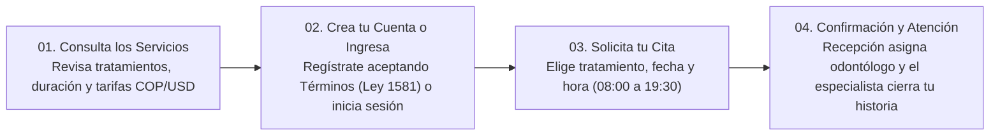

# MANUAL DE USUARIO
## DENTIX — Sistema Integral de Gestión de Citas Odontológicas

---

### Ficha de Identificación del Documento

| Campo | Detalle |
| :--- | :--- |
| **Nombre del Sistema** | DENTIX — Clínica Odontológica |
| **Programa de Formación** | Tecnología en Análisis y Desarrollo de Software (ADSO) — SENA |
| **Tipo de Documento** | Manual de Usuario y Guía Interactiva de Operación por Rol |
| **Audiencia** | Pacientes, Recepcionistas (Administradores), Odontólogos y Visitantes |
| **Fecha de Emisión** | Noviembre de 2026 |

---

## Tabla de Contenido

1. [Introducción: ¿Cómo funciona DENTIX?](#1-introducción-cómo-funciona-dentix)
2. [Recorrido Básico en 4 Pasos (Inicio Rápido)](#2-recorrido-básico-en-4-pasos-inicio-rápido)
3. [Mapa de Navegación, Idioma (ES/EN), Moneda (COP/USD) y Pie de Página](#3-mapa-de-navegación-idioma-esen-moneda-copusd-y-pie-de-página)
   - 3.1 Botones de la Barra Superior
   - 3.2 Cambio de Idioma (Español ↔ Inglés) y Moneda (COP ↔ USD)
   - 3.3 Mega Pie de Página Corporativo y Avisos Legales
4. [Guía para Pacientes (Soy Paciente)](#4-guía-para-pacientes-soy-paciente)
   - 4.1 Registro por Primera Vez (Datos Clínicos y Términos y Condiciones)
   - 4.2 Inicio de Sesión en el Portal del Paciente
   - 4.3 Mi Perfil, Estadísticas e Historial de Citas
   - 4.4 Cómo Solicitar una Cita Nueva
   - 4.5 Reglas Importantes al Agendar tu Cita (`RN-03` y `RN-07`)
5. [Guía para Especialistas (Soy Odontólogo)](#5-guía-para-especialistas-soy-odontólogo)
   - 5.1 Ingreso al Portal Médico
   - 5.2 Revisión de Mi Agenda y Alertas de Alergias
   - 5.3 Botón “Finalizada” y Registro del Detalle Clínico
   - 5.4 Historial y Buscador de Citas Finalizadas
6. [Guía para Recepción y Administración (Recepción / Admin)](#6-guía-para-recepción-y-administración-recepción--admin)
   - 6.1 Ingreso al Panel Administrativo
   - 6.2 Módulo de Citas (Confirmar, Crear, Editar y Cancelar con Motivo)
   - 6.3 Gestión de Pacientes y Cuerpo Médico (Odontólogos)
   - 6.4 Gestión del Catálogo de Servicios (Precios COP y Equivalente USD)
   - 6.5 Módulo de Reportes Clínicos y Estadísticas (Impresión PDF)
7. [Estados de una Cita y Preguntas Frecuentes](#7-estados-de-una-cita-y-preguntas-frecuentes)
   - 7.1 Significado de los Estados de una Cita
   - 7.2 Preguntas Frecuentes (FAQ)

---

## 1. Introducción: ¿Cómo funciona DENTIX?

**DENTIX** es una plataforma web diseñada para conectar a **pacientes**, **recepción** y **odontólogos** en un solo entorno digital, haciendo que solicitar, confirmar y atender citas odontológicas sea rápido, transparente y seguro.

Desde la página principal ([`index.php`](file:///opt/lampp/htdocs/DENTIX/index.php)), cualquier visitante puede explorar el catálogo público de tratamientos odontológicos, abrir la **guía interactiva (`Manual`)** en la barra superior, cambiar el idioma de toda la web entre **Español (`ES`) e Inglés (`EN`)**, visualizar las tarifas en **Pesos Colombianos (`COP`) o Dólares (`USD`)** e ingresar a su portal correspondiente según su rol.

---

## 2. Recorrido Básico en 4 Pasos (Inicio Rápido)

| Paso | Acción Principal | Descripción para el Usuario |
| :---: | :--- | :--- |
| **01** | **Consulta los Servicios** | Haz clic en **Servicios** o en **Conocer tratamientos** para ver cada procedimiento odontológico, su ícono clínico, descripción, duración estimada en minutos y tarifa de referencia en `COP` o `USD`. |
| **02** | **Crea tu Cuenta o Ingresa** | Si es tu primera vez en la clínica, pulsa **Crear cuenta de paciente**, completa tus datos y acepta los **Términos y Condiciones**. Si ya estás registrado, usa **Iniciar sesión** con tu número de cédula y contraseña. |
| **03** | **Solicita tu Cita** | Desde tu portal selecciona el tratamiento requerido, la fecha y la hora disponible (en bloques de 30 minutos entre las **08:00 a. m.** y las **07:30 p. m.**). |
| **04** | **Confirmación y Atención** | El equipo de recepción revisará tu solicitud, te asignará el especialista disponible y cambiará tu cita a estado **Confirmada**. Al concluir la atención, el odontólogo registrará el detalle clínico de cierre. |

---

## 3. Mapa de Navegación, Idioma (ES/EN), Moneda (COP/USD) y Pie de Página

### 3.1 Botones de la Barra Superior

| Botón / Enlace | Ubicación | ¿Para quién está diseñado? |
| :--- | :--- | :--- |
| **Servicios** | Menú superior | Lleva directamente a la sección de módulos y al catálogo público de tratamientos odontológicos. |
| **Agendar cita** | Menú superior | Desplaza la pantalla hacia el bloque de solicitud rápida de citas. |
| **Manual** | Menú superior | Abre el **Manual Interactivo de Usuario** (dividido en 5 pestañas) sin salir de la página actual. |
| **Odontólogos** | Botón superior derecho | Acceso exclusivo al **Panel Clínico** para los especialistas de la clínica. |
| **Administrador** | Botón superior derecho | Acceso para **Recepcionistas** al panel de control de citas, pacientes, odontólogos, servicios y reportes. |
| **Iniciar sesión** | Botón principal esmeralda | Acceso directo al **Portal del Paciente** mediante número de cédula y contraseña. |

### 3.2 Cambio de Idioma (Español ↔ Inglés) y Moneda (COP ↔ USD)
DENTIX cuenta con traducción y conversión monetaria automática en todas sus pantallas:
- **En la Página Principal (`index.php`)**: En la franja superior del pie de página encontrarás el selector de idioma (**`Español · ES` / `English · EN`**) y el selector de moneda (**`Peso colombiano (COP)` / `Dollar (USD)`**).
- **En las 22 Pantallas Internas**: En la esquina inferior derecha verás una barra flotante compacta desde la cual puedes cambiar entre **`ES` / `EN`** y **`COP` / `USD`** en cualquier momento.
- **Efecto inmediato**:
  - Al elegir **`English · EN`**, todos los títulos, menús, botones, formularios, estados de cita y alertas se traducen automáticamente al inglés.
  - Al elegir **`Dollar (USD)`**, todas las tarifas del catálogo público, de la tabla administrativa de servicios y del módulo de reportes gerenciales se convierten automáticamente a dólares estadounidenses (tasa de referencia `1 USD = $4.000 COP`).

### 3.3 Mega Pie de Página Corporativo y Avisos Legales
Al final de la página principal encontrarás el pie de página corporativo en tono blanco menta y aguamarina suave con:
- **Indicador de Estado Horario en Vivo**: muestra en tiempo real si la clínica se encuentra abierta (`08:00 a 19:30`) o si la agenda virtual 24/7 está recibiendo solicitudes para el siguiente día hábil.
- **Directorio Rápido de 15 Accesos**: enlaces directos a portales, tratamientos destacados, alertas de alergias, reportes y preguntas frecuentes.
- **Botones Legales Desplegables**: acceso a *Condiciones de uso*, *Aviso de privacidad (Ley 1581)*, *Privacidad de Datos de Salud* y *Reserva de Historia Clínica (Ley 35)*.

---

## 4. Guía para Pacientes (Soy Paciente)

### 4.1 Registro por Primera Vez (Datos Clínicos y Términos y Condiciones)
1. En la página principal, haz clic en el botón **Crear cuenta de paciente**.
2. Completa el formulario de registro ([`view/paciente/form_paciente.php`](file:///opt/lampp/htdocs/DENTIX/view/paciente/form_paciente.php)) teniendo en cuenta:
   - **Nombre Completo (Formato Nombre Propio)**: cada nombre y apellido debe iniciar con letra mayúscula seguida de minúsculas (por ejemplo: `Juan Steven` o `Laura Sofia Gomez`). El formulario formatea automáticamente tu nombre al escribirlo.
   - **Número de Cédula / Documento**: será tu usuario único para iniciar sesión.
   - **Fecha de Nacimiento**: obligatoria (no puede ser una fecha futura).
   - **Teléfono de Contacto** y **Correo Electrónico**.
   - **Alergias o Alertas Médicas**: selecciona en la lista si presentas alergias o si no tienes ninguna registrada. Si tienes alergias, puedes pulsar los **botones rápidos** (*Penicilina*, *Amoxicilina*, *Anestesia local (Lidocaína)*, *Ibuprofeno / AINEs*, *Látex*, *Aspirina*, *Yodo*, *Sulfa*) o describirlas en el campo de texto.
   - **Contraseña y Confirmación**: crea una clave segura de **entre 8 y 72 caracteres** y confírmala.
3. Pulsa **Crear cuenta**. Se abrirá automáticamente la ventana de **Términos, Condiciones y Tratamiento de Datos de Salud (Ley 1581 de 2012)**:
   - Revisa los **5 consentimientos legales** pulsando el botón **`Ver más...`** en cada uno de ellos.
   - Si intentas marcar la casilla *"He leído completamente los 5 puntos..."* o pulsar **Aceptar términos y crear cuenta** sin haber desplegado los 5 puntos con **`Ver más...`**, el sistema te mostrará un aviso indicándote cuáles cláusulas te faltan por abrir y leer.
   - Una vez desplegados los 5 puntos, marca la casilla de aceptación y pulsa **Aceptar términos y crear cuenta**.

### 4.2 Inicio de Sesión en el Portal del Paciente
1. Haz clic en **Iniciar sesión** en la barra superior.
2. Ingresa tu **Número de cédula** y tu **Contraseña**.
3. Pulsa **Iniciar sesión** para entrar a tu perfil.

### 4.3 Mi Perfil, Estadísticas e Historial de Citas
Dentro de tu perfil ([`view/paciente/perfil_paciente.php`](file:///opt/lampp/htdocs/DENTIX/view/paciente/perfil_paciente.php)) podrás:
- Ver tus **4 tarjetas de resumen**: *Total de citas*, *Pendientes*, *Confirmadas* y *Completadas*.
- Consultar y actualizar tus datos personales, teléfono, correo, fecha de nacimiento y **alertas de alergias médicas** (las cuales verá tu odontólogo antes de atenderte).
- Revisar tu **Historial de Citas** con fecha, hora, tratamiento, odontólogo asignado, estado actual y, en caso de que una cita haya sido cancelada, el **motivo de cancelación** registrado.

### 4.4 Cómo Solicitar una Cita Nueva
1. Desde tu perfil o desde la barra superior del portal, haz clic en **Agendar una cita** ([`view/paciente/portal_paciente.php`](file:///opt/lampp/htdocs/DENTIX/view/paciente/portal_paciente.php)).
2. Selecciona el **Tratamiento / Servicio** odontológico.
3. Elige la **Fecha** (desde hoy en adelante) y la **Hora** en intervalos de 30 minutos (`08:00`, `08:30`, `09:00`, ..., `19:30`).
4. Escribe opcionalmente el **Motivo o síntoma principal** de tu visita.
5. Haz clic en **Confirmar Solicitud de Cita**. Tu solicitud quedará en estado **Pendiente** para que recepción le asigne el odontólogo disponible.

### 4.5 Reglas Importantes al Agendar tu Cita (`RN-03` y `RN-07`)

> [!IMPORTANT]
> Para garantizar una atención puntual, segura y sin sobrecarga médica, el sistema aplica automáticamente las siguientes reglas de negocio:
> - **Horario de atención (`RN-03`)**: de **08:00 a. m. a 07:30 p. m.** en bloques exactos de 30 minutos (`:00` y `:30`).
> - **Una sola cita por día (`RN-07`)**: un paciente solo puede tener **una cita registrada en una misma fecha**.
> - **Espera mínima de 4 días completos entre citas (`RN-07`)**: entre una cita y otra del mismo paciente deben transcurrir al menos **4 días completos** de diferencia (por ejemplo, si tienes una cita el día **10**, podrás agendar la siguiente a partir del día **15**).

---

## 5. Guía para Especialistas (Soy Odontólogo)

### 5.1 Ingreso al Portal Médico
1. En la página principal, haz clic en **Odontólogos** en la barra superior o en **Acceso especialistas** dentro de la tarjeta de Cuerpo Médico.
2. Ingresa tu **Correo electrónico profesional** y tu **Contraseña** ([`view/odontologo/login_odontologo.php`](file:///opt/lampp/htdocs/DENTIX/view/odontologo/login_odontologo.php)).
3. Haz clic en **Ingresar a mi Agenda**.

### 5.2 Revisión de Mi Agenda y Alertas de Alergias
En tu panel principal ([`view/odontologo/panel_odontologo.php`](file:///opt/lampp/htdocs/DENTIX/view/odontologo/panel_odontologo.php)) encontrarás:
- **Tarjetas de indicadores**: *Citas por Atender*, *Citas Finalizadas* y *Mi Estado Actual* (*En Consulta* o *Disponible*).
- **Tabla “Mis Citas Asignadas (Pendientes por Atender)”**: muestra únicamente tus citas en estado **Confirmada**, incluyendo nombre del paciente, cédula, teléfono, **alerta destacada en rojo si el paciente registra alergias médicas**, tratamiento, duración, fecha y hora.

### 5.3 Botón “Finalizada” y Registro del Detalle Clínico
Al concluir la consulta de un paciente:
1. En la fila de la cita correspondiente, pulsa el botón verde **`Finalizada`**.
2. Se abrirá la ventana modal **Finalizar Cita y Reportar Detalle** con los datos del paciente y servicio precargados.
3. Completa los campos del cierre clínico (`RN-13` y `RN-14`):
   - **Fecha de salida de la cita** y **Hora de salida de la cita** (obligatorios).
   - **Resumen breve de cómo fue la cita** (obligatorio).
   - **Procedimiento realizado** (obligatorio).
   - **Extras: problemáticas o novedades presentadas** (opcional; si se deja vacío, el sistema registra *"Sin novedades o problemáticas reportadas."*).
4. Pulsa **Guardar y Finalizar Cita**. La cita pasará automáticamente a estado **Completada** y se archivará su detalle clínico.

### 5.4 Historial y Buscador de Citas Finalizadas
- Tanto en la parte inferior de tu panel como en la sección **Historial Finalizadas** del menú lateral ([`view/odontologo/historial_finalizadas.php`](file:///opt/lampp/htdocs/DENTIX/view/odontologo/historial_finalizadas.php)) puedes consultar todas las atenciones cerradas con su hora de entrada, hora de salida, resumen, procedimiento y notas clínicas.
- Utiliza la **barra de búsqueda instantánea** para filtrar tus citas atendidas por nombre del paciente, número de cédula o tratamiento, y el botón **Limpiar búsqueda** para restablecer el listado.

---

## 6. Guía para Recepción y Administración (Recepción / Admin)

### 6.1 Ingreso al Panel Administrativo
1. Haz clic en el botón **Administrador** en la barra superior de la página principal ([`view/recepcionista/lista_recepcionista.php`](file:///opt/lampp/htdocs/DENTIX/view/recepcionista/lista_recepcionista.php)).
2. Ingresa tu **Correo electrónico** y tu **Contraseña** y pulsa **Iniciar Sesión**.

### 6.2 Módulo de Citas (Confirmar, Crear, Editar y Cancelar con Motivo)
En el menú lateral selecciona **Citas** ([`view/cita/lista_citas.php`](file:///opt/lampp/htdocs/DENTIX/view/cita/lista_citas.php)):
- **Confirmar solicitudes pendientes**:
  1. En la tabla **Solicitudes pendientes de confirmación**, ubica la cita solicitada por el paciente.
  2. Selecciona un **Odontólogo activo** en la lista desplegable y pulsa **Confirmar**.
  3. El sistema verifica automáticamente la regla **`RN-08`** (cada odontólogo atiende máximo **1 cita por día**). Si el profesional ya tiene una cita asignada en esa fecha, el sistema mostrará un aviso indicando el conflicto para que elijas otro especialista.
- **Agendar Cita Manualmente (`Agendar Cita`)**: permite registrar una cita directamente desde recepción eligiendo paciente, odontólogo, servicio, fecha, hora y estado.
- **Editar Cita (`Editar`)**: permite reprogramar o actualizar cualquier cita existente.
- **Cancelar Cita con Motivo (`Cancelar`)**: al pulsar el botón rojo **Cancelar** en cualquier cita pendiente o confirmada, se abre un modal donde debes escribir obligatoriamente el **motivo de cancelación** (`RN-06`) antes de confirmar.

### 6.3 Gestión de Pacientes y Cuerpo Médico (Odontólogos)
- **Módulo Pacientes (`Pacientes`)**:
  - Lista todos los pacientes con su nombre en formato propio, cédula, teléfono, correo, fecha de nacimiento e insignia visual de **Alergias** (alerta roja si presenta alergias o etiqueta verde *"Ninguna"*).
  - Permite registrar un **Nuevo Paciente** o pulsar **Editar** para actualizar su expediente completo.
- **Módulo Odontólogos (`Odontólogos`)**:
  - Muestra cada especialista con su consultorio, especialidad, correo y estado calculado en tiempo real: **`Ocupado / En cita`** (si tiene citas confirmadas pendientes de atender), **`Activo / Disponible`** o **`Inactivo`**.
  - Desde **Editar** puedes actualizar su nombre, especialidad, consultorio, correo, contraseña opcional o cambiar su **Estado de Cuenta** (*Activo* / *Inactivo*). El identificador de enlace público (*Slug*) se actualiza automáticamente a partir del nombre del profesional.

### 6.4 Gestión del Catálogo de Servicios (Precios COP y Equivalente USD)
En el menú lateral selecciona **Servicios** ([`view/servicio/lista_servicios.php`](file:///opt/lampp/htdocs/DENTIX/view/servicio/lista_servicios.php)):
- **Crear (`Nuevo Servicio`) o Editar (`Editar`)**: define el nombre único del tratamiento, su descripción clínica, duración en minutos (mínimo 15 minutos) y precio en `COP`. Mientras escribes el precio en pesos, el formulario te muestra en tiempo real la **vista previa de su equivalente en dólares (`USD`)**.
- **Eliminar (`Eliminar`)**: permite eliminar un servicio previa confirmación, siempre que no tenga citas asociadas (`RN-12`).

### 6.5 Módulo de Reportes Clínicos y Estadísticas (Impresión PDF)
En el menú lateral selecciona **Reportes** ([`view/recepcionista/reportes.php`](file:///opt/lampp/htdocs/DENTIX/view/recepcionista/reportes.php)):
1. **Filtro por Rango de Fechas**: elige fecha inicial y fecha final y pulsa **Filtrar reporte** (o **Ver todo** para consultar el histórico completo).
2. **4 Indicadores Globales (KPIs)**: *Total Citas en Periodo*, *Ingresos Estimados* (convertibles entre `COP` y `USD`), *Tasa de Completitud* y *Canceladas / No-Show*.
3. **3 Tarjetas de Líderes**: *Paciente con Más Citas*, *Tratamiento Más Solicitado* y *Odontólogo con Mayor Atención*.
4. **Tablas Analíticas**: ranking de pacientes frecuentes, servicios más utilizados (con ingresos generados), rendimiento por odontólogo y franjas horarias pico.
5. **Imprimir / Exportar PDF**: pulsa el botón **Imprimir / Exportar PDF** para generar un informe gerencial limpio en el idioma (`ES`/`EN`) y moneda (`COP`/`USD`) que tengas activos.

---

## 7. Estados de una Cita y Preguntas Frecuentes

### 7.1 Significado de los Estados de una Cita

| Estado | Significado Operativo |
| :--- | :--- |
| **Pendiente** | El paciente registró la solicitud de cita y está a la espera de que recepción le asigne un odontólogo y confirme el horario. |
| **Confirmada** | Recepción validó la solicitud y asignó el odontólogo. El paciente debe asistir en la fecha y hora programadas y la cita aparece en la agenda del especialista. |
| **Completada** | El odontólogo finalizó la consulta mediante el botón **Finalizada** y registró fecha/hora de salida, resumen, procedimiento y nota clínica. |
| **Cancelada** | La cita fue cancelada dejando constancia obligatoria del **motivo de cancelación**, liberando el cupo en la agenda. |
| **No-Show** | Estado administrativo que registra la inasistencia del paciente a una cita programada. |

### 7.2 Preguntas Frecuentes (FAQ)

1. **¿Necesito crear una cuenta para ver los precios de los tratamientos o verlos en dólares (USD)?**
   No. Desde la página principal puedes entrar a **Conocer tratamientos** y cambiar la moneda entre **`COP`** y **`USD`** (o el idioma entre **Español** e **Inglés**) sin necesidad de iniciar sesión.
2. **¿Por qué debo pulsar “Ver más...” en los 5 puntos al registrarme como paciente?**
   En cumplimiento de la **Ley 1581 de 2012 (Habeas Data)** y la **Ley 35 de 1989**, es indispensable que conozcas cómo se protegen tus datos personales y tu historia clínica antes de autorizar la creación de tu cuenta.
3. **¿Por qué no puedo agendar dos citas el mismo día o en días consecutivos?**
   Según la regla **`RN-07`**, cada paciente puede tener máximo **1 cita por día** y deben transcurrir al menos **4 días completos** entre una cita y otra para garantizar el seguimiento clínico adecuado y la disponibilidad de agenda.
